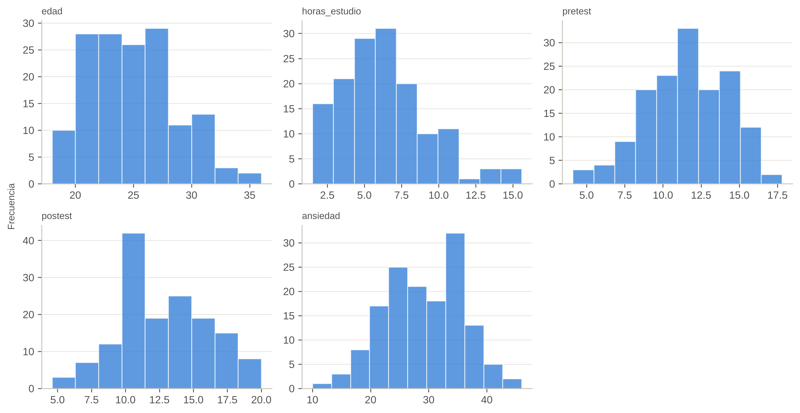
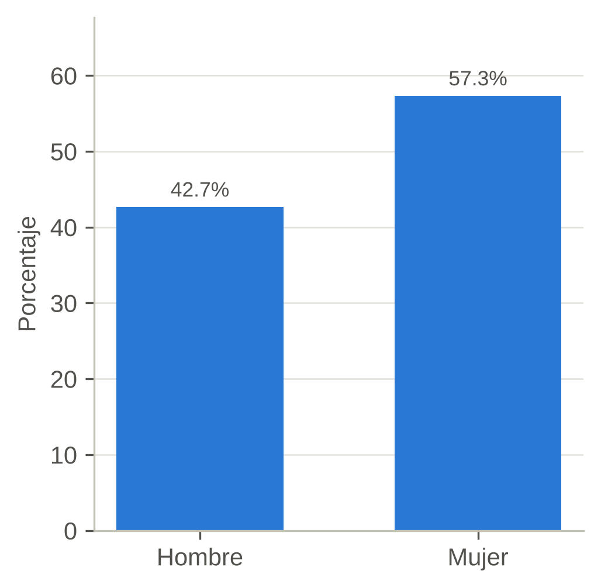
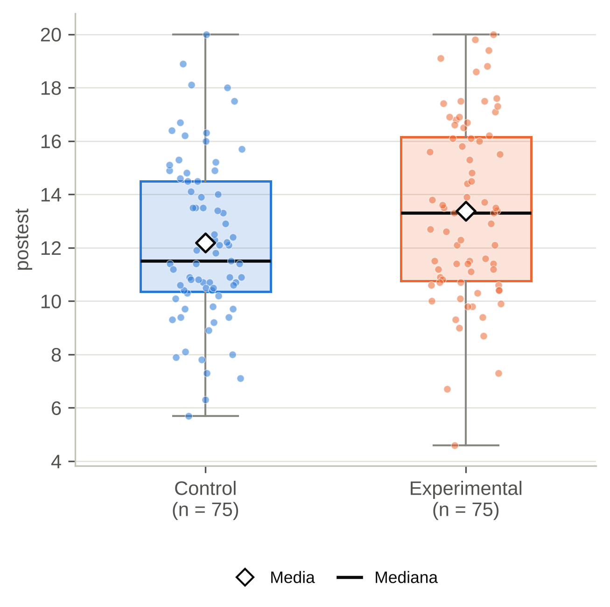
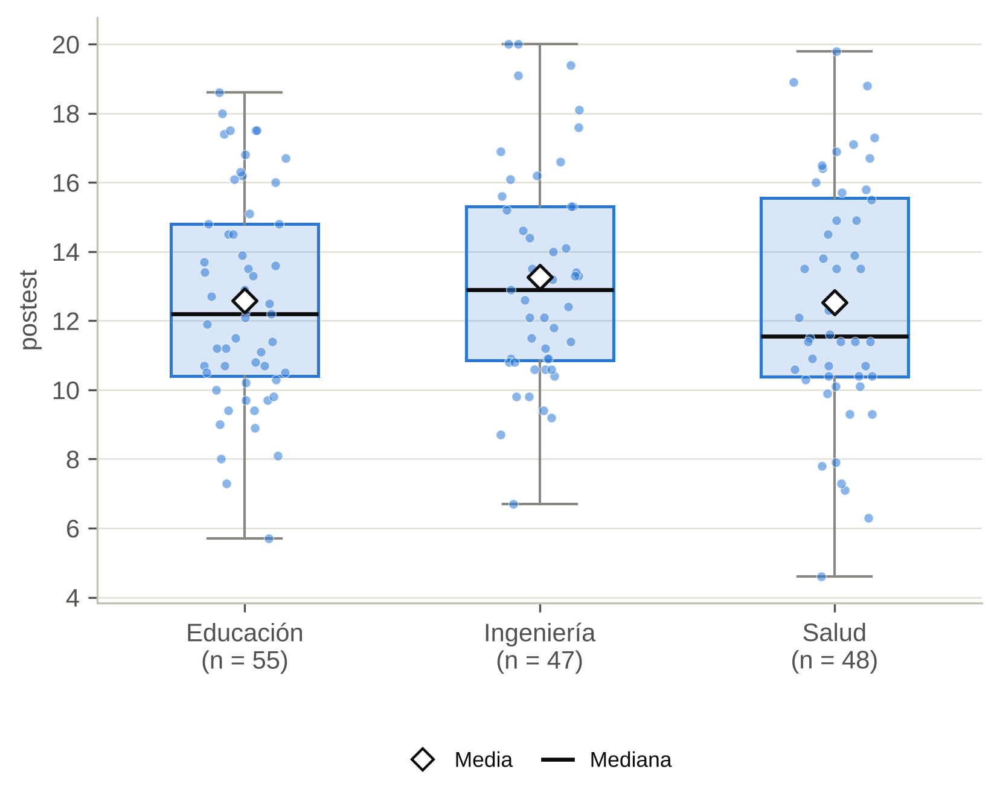
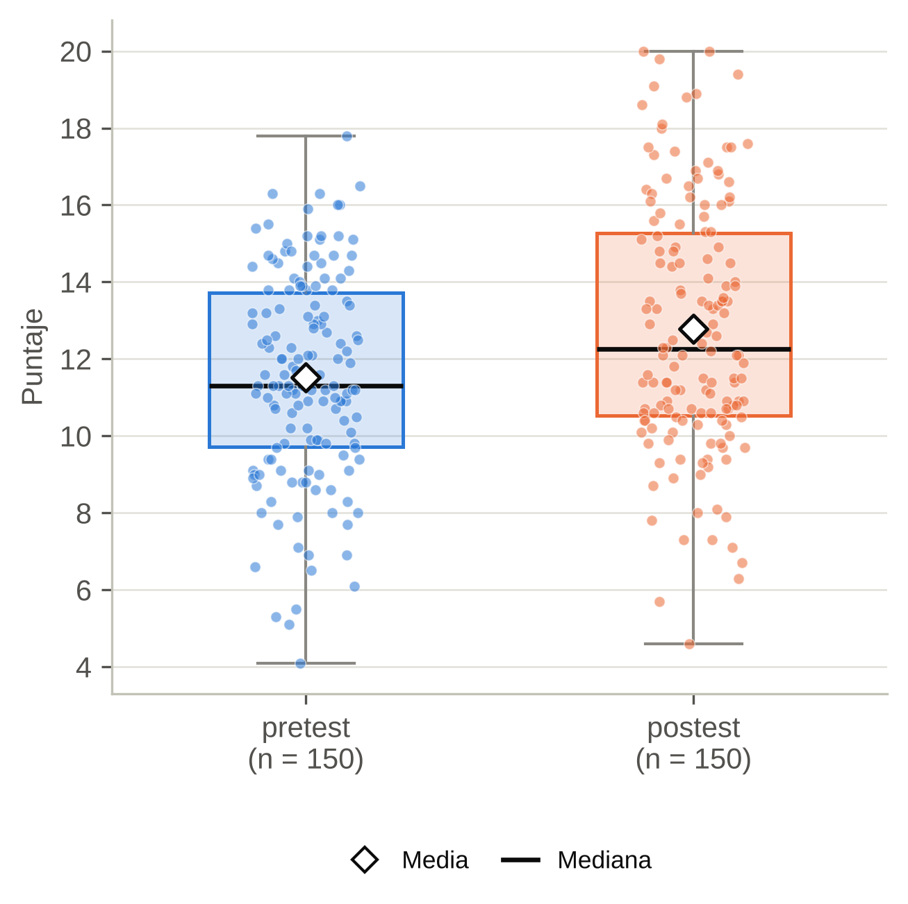
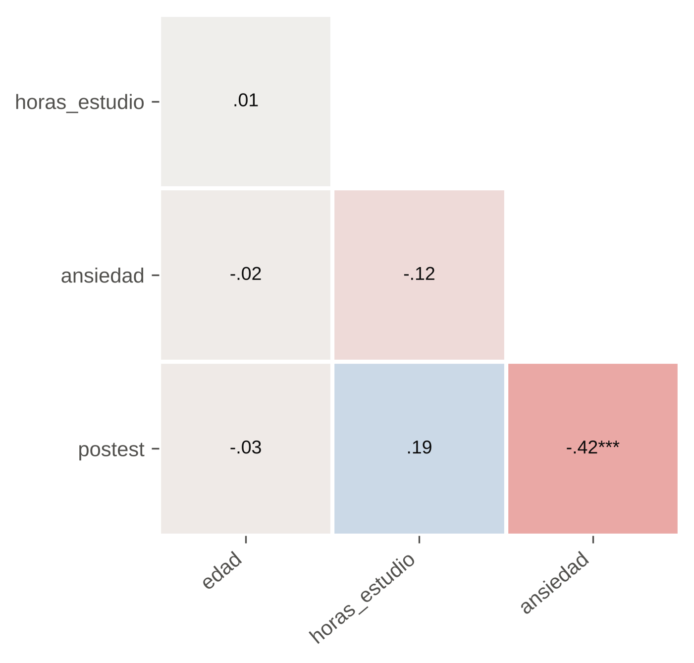
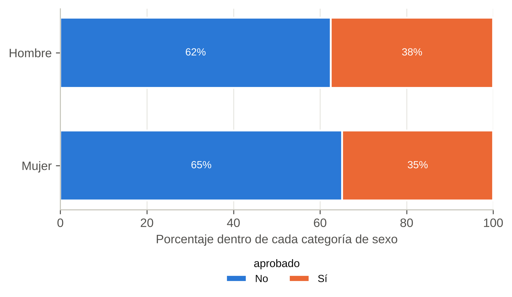
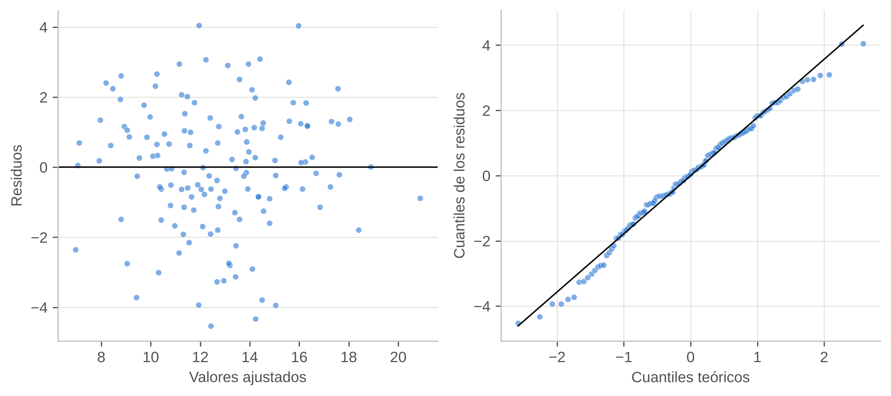
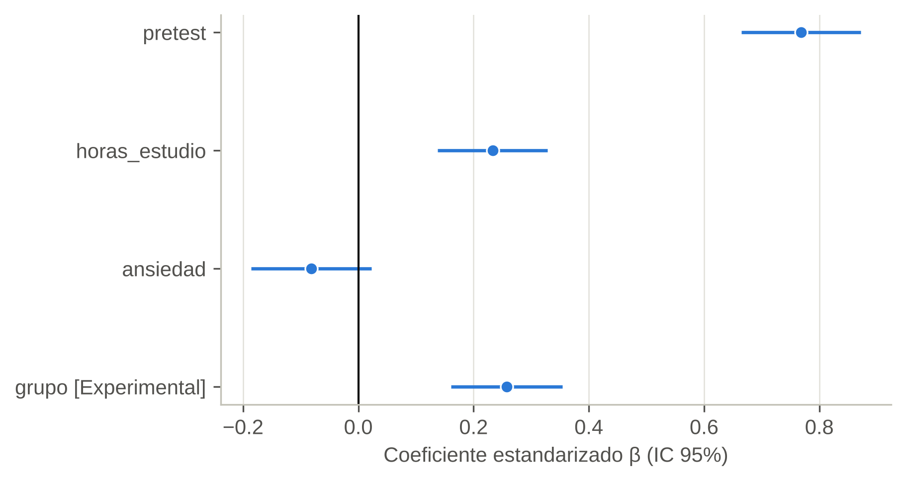

# Informe de ejemplo (datos sintéticos)

*Generado el 22/10/2026*

## Perfil de la base de datos

**Prueba aplicada:** Diagnóstico previo: tipos de variable, datos faltantes, distribución y atípicos

**Tabla 1.** *Perfil de las variables*

| Variable | Tipo detectado | n válido | % faltante | M | DE | Asimetría | Curtosis | Normalidad | Atípicos (IQR) |
|---|---|---|---|---|---|---|---|---|---|
| id | identificador (se ignora) | 150 | 0.00 |  |  |  |  |  |  |
| grupo | binaria | 150 | 0.00 |  |  |  |  |  |  |
| sexo | binaria | 150 | 0.00 |  |  |  |  |  |  |
| facultad | categórica (3 niveles) | 150 | 0.00 |  |  |  |  |  |  |
| edad | numérica continua | 150 | 0.00 | 24.41 | 3.83 | 0.48 | -0.03 | K-S (Lilliefors): p = .009 (no normal) | 2 |
| horas_estudio | numérica continua | 145 | 3.33 | 6.34 | 2.89 | 0.84 | 0.71 | K-S (Lilliefors): p = .046 (no normal) | 6 |
| pretest | numérica continua | 150 | 0.00 | 11.52 | 2.67 | -0.25 | -0.26 | K-S (Lilliefors): p = .375 (normal) | 0 |
| postest | numérica continua | 150 | 0.00 | 12.78 | 3.26 | 0.19 | -0.49 | K-S (Lilliefors): p = .002 (no normal) | 0 |
| ansiedad | numérica continua | 145 | 3.33 | 29.19 | 6.72 | -0.16 | -0.36 | K-S (Lilliefors): p = .065 (normal) | 1 |
| satisfaccion | ordinal / Likert (posible) | 150 | 0.00 | 3.35 | 0.90 | -0.12 | -0.14 | K-S (Lilliefors): p < .001 (no normal) |  |
| satisf_1 | ordinal / Likert (posible) | 150 | 0.00 | 3.19 | 0.88 | -0.25 | -0.30 | K-S (Lilliefors): p < .001 (no normal) |  |
| satisf_2 | ordinal / Likert (posible) | 150 | 0.00 | 3.07 | 0.84 | 0.21 | -0.14 | K-S (Lilliefors): p < .001 (no normal) |  |
| satisf_3 | ordinal / Likert (posible) | 150 | 0.00 | 3.19 | 0.81 | -0.12 | -0.21 | K-S (Lilliefors): p < .001 (no normal) |  |
| satisf_4 | ordinal / Likert (posible) | 150 | 0.00 | 3.15 | 0.85 | 0.24 | -0.06 | K-S (Lilliefors): p < .001 (no normal) |  |
| satisf_5 | ordinal / Likert (posible) | 150 | 0.00 | 3.19 | 0.79 | 0.05 | 0.19 | K-S (Lilliefors): p < .001 (no normal) |  |
| aprobado | binaria | 150 | 0.00 |  |  |  |  |  |  |

**Figura 1.** *Distribución de las variables numéricas principales*

**Redacción de resultados (lista para tu tesis o artículo)**

La base de datos analizada estuvo conformada por 150 registros y 16 variables. Antes de los análisis inferenciales se revisaron los tipos de variable, los datos faltantes, los valores atípicos y el supuesto de normalidad de las variables numéricas.

**Advertencias**

- 'ansiedad' tiene 1 valor(es) atípico(s) (regla 1.5×IQR). Verifica si son errores de digitación antes de excluirlos.
- 'edad' tiene 2 valor(es) atípico(s) (regla 1.5×IQR). Verifica si son errores de digitación antes de excluirlos.
- 'horas_estudio' tiene 6 valor(es) atípico(s) (regla 1.5×IQR). Verifica si son errores de digitación antes de excluirlos.
- 'satisf_1' parece una escala ordinal (pocos valores enteros). Para comparar grupos o correlacionar considera pruebas no paramétricas (ordinal=True).
- 'satisf_2' parece una escala ordinal (pocos valores enteros). Para comparar grupos o correlacionar considera pruebas no paramétricas (ordinal=True).
- 'satisf_3' parece una escala ordinal (pocos valores enteros). Para comparar grupos o correlacionar considera pruebas no paramétricas (ordinal=True).
- 'satisf_4' parece una escala ordinal (pocos valores enteros). Para comparar grupos o correlacionar considera pruebas no paramétricas (ordinal=True).
- 'satisf_5' parece una escala ordinal (pocos valores enteros). Para comparar grupos o correlacionar considera pruebas no paramétricas (ordinal=True).
- 'satisfaccion' parece una escala ordinal (pocos valores enteros). Para comparar grupos o correlacionar considera pruebas no paramétricas (ordinal=True).

---

## Distribución de frecuencias de sexo

**Prueba aplicada:** Frecuencias y porcentajes

**Tabla 2.** *Distribución de sexo*

| sexo | f | % |
|---|---|---|
| Hombre | 64 | 42.67 |
| Mujer | 86 | 57.33 |
| Total | 150 | 100.00 |

**Figura 2.** *Distribución porcentual de sexo*

**Redacción de resultados (lista para tu tesis o artículo)**

Respecto a sexo, de los 150 casos válidos, la categoría más frecuente fue «Mujer» (*f* = 86; 57.3%).

---

## Estadísticos descriptivos

**Prueba aplicada:** Medidas de tendencia central y dispersión

**Tabla 3.** *Estadísticos descriptivos*

| Variable | grupo | n | M | DE | Mdn | RIC | Mín | Máx | Asimetría | Curtosis |
|---|---|---|---|---|---|---|---|---|---|---|
| edad | Control | 75 | 24.27 | 3.69 | 24.00 | 5.00 | 18.00 | 36.00 | 0.632 | 0.41 |
| edad | Experimental | 75 | 24.56 | 3.97 | 24.00 | 5.50 | 18.00 | 36.00 | 0.346 | -0.30 |
| horas_estudio | Control | 72 | 6.24 | 2.88 | 6.10 | 3.62 | 1.80 | 14.70 | 0.800 | 0.66 |
| horas_estudio | Experimental | 73 | 6.44 | 2.92 | 5.80 | 3.50 | 1.50 | 15.60 | 0.892 | 0.87 |
| pretest | Control | 75 | 11.84 | 2.45 | 11.60 | 3.35 | 4.10 | 16.50 | -0.469 | 0.46 |
| pretest | Experimental | 75 | 11.20 | 2.86 | 11.20 | 4.25 | 5.10 | 17.80 | -0.030 | -0.60 |
| postest | Control | 75 | 12.18 | 3.06 | 11.50 | 4.15 | 5.70 | 20.00 | 0.326 | -0.24 |
| postest | Experimental | 75 | 13.37 | 3.36 | 13.30 | 5.40 | 4.60 | 20.00 | 0.009 | -0.54 |

*Nota. M = media; DE = desviación estándar; Mdn = mediana; RIC = rango intercuartílico (Q3 − Q1).*

**Redacción de resultados (lista para tu tesis o artículo)**

Los estadísticos descriptivos fueron los siguientes: edad (Control): *M* = 24.27, *DE* = 3.69 (*n* = 75); edad (Experimental): *M* = 24.56, *DE* = 3.97 (*n* = 75); horas_estudio (Control): *M* = 6.24, *DE* = 2.88 (*n* = 72); horas_estudio (Experimental): *M* = 6.44, *DE* = 2.92 (*n* = 73); pretest (Control): *M* = 11.84, *DE* = 2.45 (*n* = 75); pretest (Experimental): *M* = 11.20, *DE* = 2.86 (*n* = 75); postest (Control): *M* = 12.18, *DE* = 3.06 (*n* = 75); postest (Experimental): *M* = 13.37, *DE* = 3.36 (*n* = 75).

---

## Comparación de postest según grupo

**Prueba aplicada:** t de Student para muestras independientes

**Verificación de supuestos**

- Normalidad por grupo (Kolmogorov-Smirnov (Lilliefors)): Control: *p* = .073 → normal; Experimental: *p* = .077 → normal
- Homogeneidad de varianzas (Levene): *p* = .294 → varianzas homogéneas

**Hipótesis estadísticas**

- H₀: No existen diferencias estadísticamente significativas en postest entre Control y Experimental.
- H₁: Existen diferencias estadísticamente significativas en postest entre Control y Experimental.
- Decisión: Como *p* = .024 es menor que α = .05, se rechaza H₀.

**Tabla 4.** *Estadísticos descriptivos por grupo*

| Grupo | n | M | DE | Mdn | RIC | Mín | Máx |
|---|---|---|---|---|---|---|---|
| Control | 75 | 12.18 | 3.06 | 11.50 | 4.15 | 5.70 | 20.00 |
| Experimental | 75 | 13.37 | 3.36 | 13.30 | 5.40 | 4.60 | 20.00 |

*Nota. M = media; DE = desviación estándar; Mdn = mediana; RIC = rango intercuartílico (Q3 − Q1).*

**Tabla 5.** *Comparación*

| Prueba | t | gl | p | Dif. de medias | IC 95% inf. | IC 95% sup. | d de Cohen |
|---|---|---|---|---|---|---|---|
| t de Student para muestras independientes | -2.28 | 148 | .024 | -1.19 | -2.23 | -0.16 | -0.37 |

*Nota. d de Cohen calculada con la desviación estándar agrupada; IC = intervalo de confianza de la diferencia de medias (grupo 1 − grupo 2).*

**Figura 3.** *Distribución de postest según grupo*

**Redacción de resultados (lista para tu tesis o artículo)**

Se aplicó la prueba t de Student para muestras independientes para comparar postest entre Control (*M* = 12.18, *DE* = 3.06, *n* = 75) y Experimental (*M* = 13.37, *DE* = 3.36, *n* = 75). Los resultados evidencian diferencias estadísticamente significativas, *t*(148) = -2.28, *p* = .024, IC 95% de la diferencia de medias [-2.23, -0.16], *d* de Cohen = -0.37, correspondiente a un tamaño del efecto pequeño. Los valores de postest fueron más altos en el grupo Experimental (media = 13.37). Por tanto, se rechaza la hipótesis nula.

**Justificación para el capítulo de método**

Se evaluó la normalidad de postest en cada grupo mediante la prueba de Kolmogorov-Smirnov (Lilliefors) y la homogeneidad de varianzas mediante la prueba de Levene. Dado que ambos grupos cumplieron el supuesto de normalidad y las varianzas fueron homogéneas, se empleó la prueba t de Student para muestras independientes, acompañada del tamaño del efecto d de Cohen. Se adoptó un nivel de significancia de α = .05.

---

## Comparación de postest según facultad

**Prueba aplicada:** ANOVA de un factor

**Verificación de supuestos**

- Normalidad por grupo (Kolmogorov-Smirnov (Lilliefors)): Educación: *p* > .20 → normal; Ingeniería: *p* = .151 → normal; Salud: *p* = .498 → normal
- Homogeneidad de varianzas (Levene): *p* = .468 → varianzas homogéneas

**Hipótesis estadísticas**

- H₀: Las medidas de postest no difieren de manera estadísticamente significativa entre los grupos de facultad.
- H₁: Al menos un grupo de facultad difiere significativamente en postest.
- Decisión: Como *p* = .469 es mayor o igual que α = .05, no se rechaza H₀.

**Tabla 6.** *Estadísticos descriptivos por grupo*

| Grupo | n | M | DE | Mdn | RIC | Mín | Máx |
|---|---|---|---|---|---|---|---|
| Educación | 55 | 12.58 | 3.08 | 12.20 | 4.40 | 5.70 | 18.60 |
| Ingeniería | 47 | 13.26 | 3.17 | 12.90 | 4.45 | 6.70 | 20.00 |
| Salud | 48 | 12.52 | 3.54 | 11.55 | 5.18 | 4.60 | 19.80 |

*Nota. M = media; DE = desviación estándar; Mdn = mediana; RIC = rango intercuartílico (Q3 − Q1).*

**Tabla 7.** *Tabla ANOVA*

| Fuente | SC | gl | MC | F | p |
|---|---|---|---|---|---|
| Entre grupos | 16.20 | 2 | 8.10 | 0.76 | .469 |
| Dentro de grupos | 1563.47 | 147 | 10.64 |  |  |
| Total | 1579.67 | 149 |  |  |  |

**Figura 4.** *Distribución de postest según facultad*

**Redacción de resultados (lista para tu tesis o artículo)**

Se aplicó la prueba ANOVA de un factor para comparar postest entre 3 grupos de facultad: Educación (*M* = 12.58, *DE* = 3.08, *n* = 55); Ingeniería (*M* = 13.26, *DE* = 3.17, *n* = 47); Salud (*M* = 12.52, *DE* = 3.54, *n* = 48). Los resultados no evidencian diferencias estadísticamente significativas entre los grupos, *F*(2, 147) = 0.76, *p* = .469, *η*² = .01, que indica un tamaño del efecto pequeño. Por tanto, no se rechaza la hipótesis nula: no se halló evidencia suficiente de diferencias entre los grupos, y no corresponde realizar comparaciones post hoc.

**Justificación para el capítulo de método**

Se evaluó la normalidad de postest en cada grupo mediante la prueba de Kolmogorov-Smirnov (Lilliefors) y la homogeneidad de varianzas mediante la prueba de Levene. Dado que todos los grupos cumplieron el supuesto de normalidad y las varianzas fueron homogéneas, se empleó la prueba ANOVA de un factor y el tamaño del efecto η². Se adoptó un nivel de significancia de α = .05.

---

## Comparación de pretest y postest (muestras relacionadas)

**Prueba aplicada:** t de Student para muestras relacionadas

**Verificación de supuestos**

- Normalidad de las diferencias (postest − pretest) con Kolmogorov-Smirnov (Lilliefors): *p* = .075 → normal

**Hipótesis estadísticas**

- H₀: No existen diferencias estadísticamente significativas entre pretest y postest.
- H₁: Existen diferencias estadísticamente significativas entre pretest y postest.
- Decisión: Como *p* < .001 es menor que α = .05, se rechaza H₀.

**Tabla 8.** *Estadísticos descriptivos*

| Medición | n | M | DE | Mdn | RIC |
|---|---|---|---|---|---|
| pretest | 150 | 11.52 | 2.67 | 11.30 | 4.00 |
| postest | 150 | 12.78 | 3.26 | 12.25 | 4.75 |

**Tabla 9.** *Comparación*

| Prueba | t | gl | p | Dif. de medias | IC 95% inf. | IC 95% sup. | d de Cohen |
|---|---|---|---|---|---|---|---|
| t de Student para muestras relacionadas | 7.11 | 149 | < .001 | 1.25 | 0.91 | 1.60 | 0.58 |

*Nota. Diferencia = medición final − medición inicial; d de Cohen = diferencia media / DE de las diferencias (d_z).*

**Figura 5.** *Distribución de pretest y postest*

**Redacción de resultados (lista para tu tesis o artículo)**

Se aplicó la prueba t de Student para muestras relacionadas (*n* = 150 pares) para comparar pretest (*M* = 11.52, *DE* = 2.67) con postest (*M* = 12.78, *DE* = 3.26). Los resultados evidencian una diferencia estadísticamente significativa, *t*(149) = 7.11, *p* < .001, IC 95% de la diferencia [0.91, 1.60], *d* de Cohen = 0.58, lo que corresponde a un tamaño del efecto mediano. Entre pretest y postest se observó un aumento (media de las diferencias = 1.25). Por tanto, se rechaza la hipótesis nula.

**Justificación para el capítulo de método**

Se evaluó la normalidad de las diferencias entre postest y pretest mediante la prueba de Kolmogorov-Smirnov (Lilliefors). Dado que la distribución de las diferencias fue normal, se empleó la prueba t de Student para muestras relacionadas, junto con el tamaño del efecto d de Cohen (d_z). Se adoptó un nivel de significancia de α = .05.

---

## Matriz de correlaciones

**Prueba aplicada:** Correlación rho (ρ) de Spearman (matriz de 4 variables)

**Verificación de supuestos**

- Normalidad de edad (Kolmogorov-Smirnov (Lilliefors)): *p* = .009 → no normal
- Normalidad de horas_estudio (Kolmogorov-Smirnov (Lilliefors)): *p* = .046 → no normal
- Normalidad de ansiedad (Kolmogorov-Smirnov (Lilliefors)): *p* = .065 → normal
- Normalidad de postest (Kolmogorov-Smirnov (Lilliefors)): *p* = .002 → no normal

**Tabla 10.** *Matriz de correlaciones (rho (ρ) de Spearman)*

| Variable | 1 | 2 | 3 |
|---|---|---|---|
| 1. edad | — |  |  |
| 2. horas_estudio | .01 | — |  |
| 3. ansiedad | -.02 | -.12 | — |
| 4. postest | -.03 | .19 | -.42*** |

*Nota. \*p < .05. \*\*p < .01. \*\*\*p < .001 (ajustado con Holm).*

**Tabla 11.** *Detalle por par de variables*

| Par | ρ | n | p | p ajustada |
|---|---|---|---|---|
| edad – horas_estudio | .01 | 145 | .932 | 1.000 |
| edad – ansiedad | -.02 | 145 | .825 | 1.000 |
| edad – postest | -.03 | 150 | .756 | 1.000 |
| horas_estudio – ansiedad | -.12 | 141 | .148 | .591 |
| horas_estudio – postest | .19 | 145 | .026 | .129 |
| ansiedad – postest | -.42 | 145 | < .001 | < .001 |

**Figura 6.** *Mapa de calor de las correlaciones (azul = positiva, rojo = negativa)*

**Redacción de resultados (lista para tu tesis o artículo)**

Se calculó la matriz de correlaciones con el coeficiente rho (ρ) de Spearman entre 4 variables (edad; horas_estudio; ansiedad; postest). Se halló 1 correlación estadísticamente significativa de un total de 6 (valores *p* ajustados con Holm). La de mayor magnitud fue: ansiedad – postest: *ρ* = -.42, *p* < .001.

**Justificación para el capítulo de método**

Se evaluó la normalidad de cada variable con la prueba de Kolmogorov-Smirnov (Lilliefors). Dado que al menos una variable no fue normal u ordinal, se utilizó el coeficiente rho (ρ) de Spearman para toda la matriz, con ajuste de Holm por comparaciones múltiples. Nivel de significancia α = .05.

---

## Asociación entre sexo y aprobado

**Prueba aplicada:** Chi cuadrado de independencia de Pearson

**Verificación de supuestos**

- Frecuencias esperadas: mínima = 23.04; 0.0% de las casillas con frecuencia esperada < 5 → se cumple el supuesto

**Hipótesis estadísticas**

- H₀: sexo y aprobado son independientes (no existe asociación).
- H₁: sexo y aprobado no son independientes (existe asociación).
- Decisión: Como *p* = .741 es mayor o igual que α = .05, no se rechaza H₀.

**Tabla 12.** *Tabla de contingencia, n (% por fila)*

| sexo | aprobado: No | aprobado: Sí | Total |
|---|---|---|---|
| Hombre | 40 (62.5%) | 24 (37.5%) | 64 (100%) |
| Mujer | 56 (65.1%) | 30 (34.9%) | 86 (100%) |
| Total | 96 (64.0%) | 54 (36.0%) | 150 (100%) |

**Tabla 13.** *Contraste de asociación*

| Prueba | χ² | gl | p | φ | n | OR | IC 95% inf. | IC 95% sup. |
|---|---|---|---|---|---|---|---|---|
| Chi cuadrado de independencia de Pearson | 0.11 | 1 | .741 | .03 | 150 | 0.89 | 0.46 | 1.75 |

*Nota. φ = coeficiente phi (tablas 2 × 2); V = V de Cramér; OR = razón de momios (odds ratio) con IC 95%.*

**Figura 7.** *Distribución porcentual de aprobado según sexo*

**Redacción de resultados (lista para tu tesis o artículo)**

Se aplicó la prueba chi cuadrado de independencia de Pearson para analizar la asociación entre sexo y aprobado (*N* = 150). Los resultados no evidencian una asociación estadísticamente significativa, *χ*²(1, *N* = 150) = 0.11, *p* = .741, *φ* = .03. Por tanto, no se rechaza la hipótesis nula: no hay evidencia suficiente de asociación entre las variables.

**Justificación para el capítulo de método**

Para analizar la asociación entre las variables categóricas sexo y aprobado se utilizó la prueba chi cuadrado de independencia de Pearson, dado que todas las frecuencias esperadas fueron adecuadas (≥ 5). Como medida del tamaño del efecto se empleó phi (φ) (.10 pequeño, .30 mediano, .50 grande). Nivel de significancia α = .05.

---

## Regresión lineal múltiple: postest

**Prueba aplicada:** Regresión lineal múltiple por mínimos cuadrados ordinarios

**Verificación de supuestos**

- Normalidad de los residuos (Kolmogorov-Smirnov (Lilliefors)): *p* > .20 → normal
- Homocedasticidad (Breusch-Pagan): *p* = .664 → varianza constante
- Multicolinealidad (VIF máximo): 1.25 → adecuada (< 5)
- Independencia de residuos (Durbin-Watson): 1.96 → aceptable (1.5–2.5)
- Casos influyentes (distancia de Cook > 4/n): 3

**Hipótesis estadísticas**

- H₀: Los predictores (pretest, horas_estudio, ansiedad, grupo) no explican de manera significativa la variabilidad de postest (R² = 0).
- H₁: Al menos un predictor (pretest, horas_estudio, ansiedad, grupo) explica de manera significativa la variabilidad de postest (R² > 0).
- Decisión: Como *p* < .001 es menor que α = .05, se rechaza H₀ (prueba F del modelo global).

**Tabla 14.** *Resumen del modelo*

| R | R² | R² aj. | EE de la estimación | F | gl1 | gl2 | p | Durbin-Watson |
|---|---|---|---|---|---|---|---|---|
| .83 | .70 | .69 | 1.80 | 78.29 | 4 | 136 | < .001 | 1.96 |

*Nota. R² aj. = R² ajustado.*

**Tabla 15.** *Coeficientes de regresión*

| Variable | B | EE | β | t | p | IC 95% inf. | IC 95% sup. | VIF |
|---|---|---|---|---|---|---|---|---|
| Constante | 0.86 | 1.38 |  | 0.62 | .535 | -1.88 | 3.60 |  |
| pretest | 0.92 | 0.06 | .77 | 14.71 | < .001 | 0.80 | 1.05 | 1.23 |
| horas_estudio | 0.26 | 0.05 | .23 | 4.84 | < .001 | 0.15 | 0.36 | 1.04 |
| ansiedad | -0.04 | 0.03 | -.08 | -1.55 | .124 | -0.09 | 0.01 | 1.25 |
| grupo [Experimental] | 1.65 | 0.31 | .26 | 5.28 | < .001 | 1.03 | 2.27 | 1.07 |

*Nota. B = coeficiente no estandarizado; EE = error estándar; β = coeficiente estandarizado; IC = intervalo de confianza al 95% de B; VIF = factor de inflación de la varianza.*

**Figura 8.** *Diagnóstico del modelo: residuos vs. valores ajustados (izquierda) y gráfico Q-Q de los residuos (derecha)*

**Figura 9.** *Coeficientes estandarizados (β) con intervalo de confianza al 95%*

**Redacción de resultados (lista para tu tesis o artículo)**

Se ajustó un modelo de regresión lineal múltiple para explicar postest a partir de pretest, horas_estudio, ansiedad, grupo (*n* = 141). El modelo resultó estadísticamente significativo, *F*(4, 136) = 78.29, *p* < .001, y explicó el 69.7% de la varianza de postest (*R*² = .70; *R*² ajustado = .69), un efecto grande. Los predictores con efecto estadísticamente significativo fueron: pretest (*B* = 0.92, *β* = .77, *p* < .001); horas_estudio (*B* = 0.26, *β* = .23, *p* < .001); grupo [Experimental] (*B* = 1.65, *β* = .26, *p* < .001). Por cada unidad adicional en pretest, postest aumenta en promedio 0.92 unidades, manteniendo constantes los demás predictores. Por tanto, se rechaza la hipótesis nula.

**Justificación para el capítulo de método**

Se estimó un modelo de regresión lineal múltiple por mínimos cuadrados ordinarios. Se verificaron los supuestos de normalidad de los residuos (Kolmogorov-Smirnov (Lilliefors)), homocedasticidad (Breusch-Pagan), ausencia de multicolinealidad (factor de inflación de la varianza, VIF), independencia de los errores (Durbin-Watson) y casos influyentes (distancia de Cook). El tamaño del efecto se evaluó con R² (criterios de Cohen, 1988: .02, .13 y .26). Nivel de significancia α = .05.

**Advertencias**

- 'grupo' es categórica: se codificó con indicadoras; categoría de referencia = «Control».
- Se excluyeron 9 caso(s) con datos faltantes (eliminación por lista).

---

## Tamaño de muestra (estimación de proporciones)

**Prueba aplicada:** Fórmula de muestreo para población finita (Cochran, 1977)

**Tabla 16.** *Cálculo del tamaño de muestra*

| Parámetro | Valor |
|---|---|
| Nivel de confianza | 95% |
| Valor Z | 1.96 |
| Margen de error (e) | 5.0% |
| Proporción esperada (p) | 0.50 |
| q = 1 − p | 0.50 |
| Población (N) | 1200 |
| Tamaño de muestra (n) | 292 |

**Redacción de resultados (lista para tu tesis o artículo)**

Para determinar el tamaño de la muestra se utilizó la fórmula para estimar proporciones en poblaciones finitas (n = N·Z²·p·q / [e²·(N − 1) + Z²·p·q]), con un nivel de confianza del 95% (*Z* = 1.96), un margen de error del 5.0%, una proporción esperada *p* = 0.50 (*q* = 0.50) y una población de *N* = 1200. El resultado fue una muestra de *n* = 292 participantes.

**Justificación para el capítulo de método**

Para determinar el tamaño de la muestra se utilizó la fórmula para estimar proporciones en poblaciones finitas (n = N·Z²·p·q / [e²·(N − 1) + Z²·p·q]), con un nivel de confianza del 95% (*Z* = 1.96), un margen de error del 5.0%, una proporción esperada *p* = 0.50 (*q* = 0.50) y una población de *N* = 1200. El resultado fue una muestra de *n* = 292 participantes.

**Advertencias**

- Esta fórmula sirve para ESTIMAR proporciones en encuestas (muestreo probabilístico). No es un análisis de potencia: si tu objetivo es contrastar hipótesis (comparar grupos, correlacionar), usa potencia_muestra().
- Si no tienes información previa sobre p, usar p = 0.5 da el mayor tamaño de muestra (caso más conservador).
- Agrega a n un porcentaje por posibles no respuestas (por ejemplo, 10%) si tu diseño lo requiere.

---

## Tamaño de muestra por análisis de potencia

**Prueba aplicada:** Análisis de potencia a priori

**Tabla 17.** *Cálculo de la potencia*

| Parámetro | Valor |
|---|---|
| Prueba | comparación de dos grupos independientes (t de Student) |
| Tamaño del efecto (d de Cohen) | 0.50 |
| Nivel de significancia (α) | .05 |
| Potencia (1 − β) | .80 |
| Contraste | bilateral |
| Tamaño de muestra necesario (participantes por grupo) | 64 |
| Tamaño de muestra total | 128 |

**Redacción de resultados (lista para tu tesis o artículo)**

Se realizó un análisis de potencia a priori para una comparación de dos grupos independientes (t de Student), con un tamaño del efecto esperado d de Cohen = 0.50, un nivel de significancia α = .05 y una potencia estadística de .80 (contraste bilateral). Se requiere una muestra de 64 participantes por grupo (total = 128).

**Justificación para el capítulo de método**

Se realizó un análisis de potencia a priori para una comparación de dos grupos independientes (t de Student), con un tamaño del efecto esperado d de Cohen = 0.50, un nivel de significancia α = .05 y una potencia estadística de .80 (contraste bilateral). Se requiere una muestra de 64 participantes por grupo (total = 128). El cálculo se realizó con Python (SciPy y statsmodels).

**Advertencias**

- Añade un margen por posibles abandonos o datos faltantes (por ejemplo, 10–15%).

---

## Software utilizado

Los análisis se realizaron con Python 3 utilizando las bibliotecas SciPy (Virtanen et al., 2020), statsmodels (Seabold y Perktold, 2010), pandas y matplotlib. El nivel de significancia fue α = .05.
